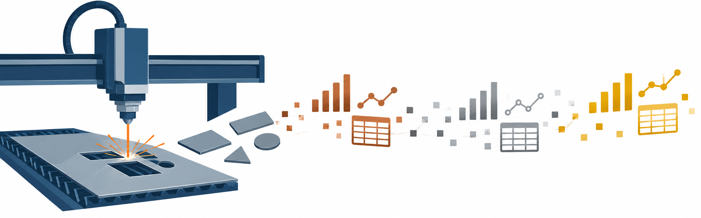
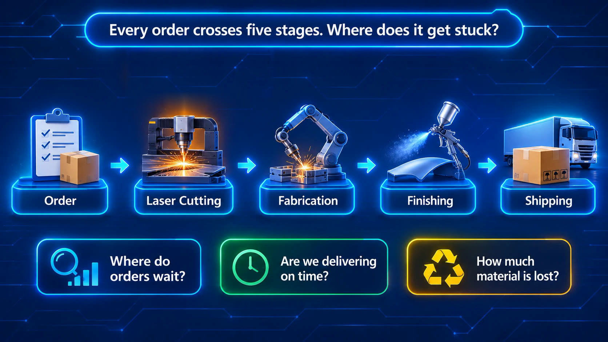
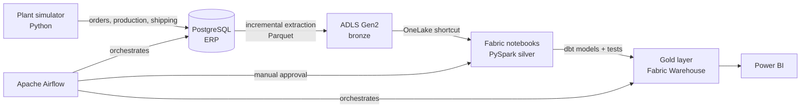
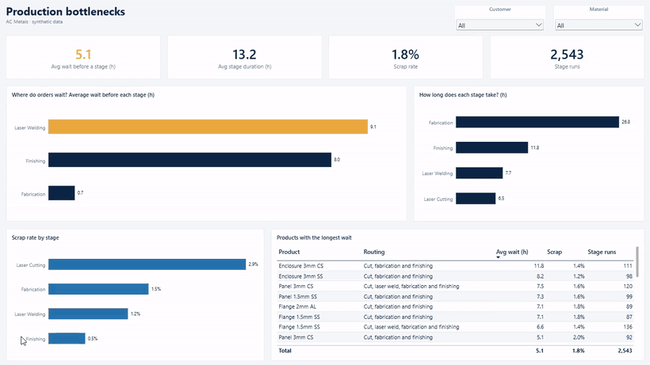
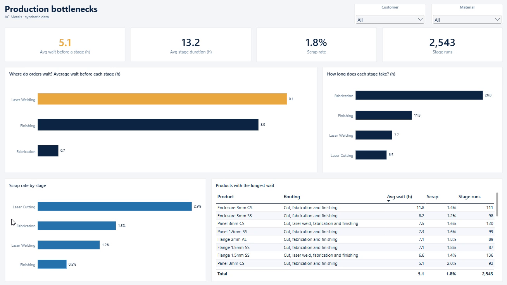
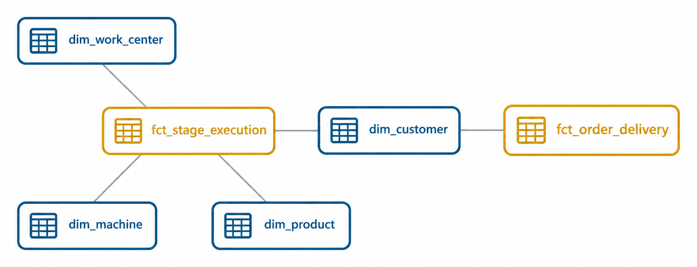

# Industrial Data Platform




End-to-end data engineering platform on **Azure** and **Microsoft Fabric** for metal fabrication plants, built around a real case: **AC Metais**, a Brazilian laser cutting and boilermaking company.

> ✅ **Complete:** batch lakehouse on Azure and Microsoft Fabric, dbt star schema with tests, a three-page Power BI report, CI and a local Airflow DAG. See [what was built](#what-was-built).

## The problem



Every order at AC Metais follows the same path:

```
Order → Laser cutting → Fabrication → Finishing → Shipping
```

Some products also go through **laser welding** between cutting and fabrication.

Questions the business asks every day, and that are hard to answer without a data platform:

- **Where is the bottleneck?** Which stage is slowing orders down?
- **Will this order be late?** What is the real lead time of each stage?
- **How efficient is the laser?** How much time is it idle, and how much sheet metal becomes scrap?
- **What is the real margin of each order** after scrap, rework and machine hours?
- **Are we delivering on time?**

## The solution

A cloud data platform that extracts data from the plant's ERP, organizes it in a lakehouse with bronze, silver and gold layers, and turns it into decisions for production planning.


<details>
<summary><b>Technical architecture</b></summary>



Each step and its trade-offs are recorded in [docs/decisions.md](docs/decisions.md).

</details>

### How the data flows

| Layer | What happens | Where |
|---|---|---|
| **Source** | A simulator writes orders, production events, inspections and shipments into a PostgreSQL ERP | Docker |
| **Bronze** | Only rows that changed since the last run are extracted to Parquet and uploaded to the lake | ADLS Gen2 |
| **Silver** | PySpark keeps the latest version of each row and runs data quality checks | Fabric Lakehouse (Delta) |
| **Gold** | dbt builds a star schema with tests | Fabric Warehouse |
| **Consumption** | Dashboard for production planning | Power BI |

## Dashboard



| Production bottlenecks | On-time delivery | Order margin |
|---|---|---|
|  |  |  |

Power BI on top of the gold layer. Orders wait the longest before laser welding (9 hours on average) and finishing, and 82% of the orders were on time, with a dip in September; an order past its promised date and not yet delivered counts as late. Shipped orders keep about half of their revenue after material, processing and freight. The report pages are generated as code; see [powerbi/](powerbi/).

## Data model

The gold layer is a star schema with three facts at different grains, sharing the customer dimension.



| Table | Grain | Answers |
|---|---|---|
| `fct_stage_execution` | one row per production order and routing step | lead time per stage, bottlenecks, scrap |
| `fct_order_delivery` | one row per sales order | order lead time, days late, on-time delivery, freight |
| `fct_order_margin` | one row per shipped sales order | revenue, material, processing and freight cost, margin |

### Modules

| Module | Business question | Status |
|---|---|---|
| **Production planning (PCP)** | Bottlenecks, lead time per stage, late orders | ✅ data model ready |
| **Finance** | Real margin per order | ✅ data model ready |
| **Logistics** | On-time delivery, freight cost | ✅ data model ready |

## Tech stack

| Layer | Tool | Status |
|---|---|---|
| Source system (ERP) | PostgreSQL (Docker) | ✅ |
| Plant simulator | Python (Faker, psycopg) | ✅ |
| Extraction | Python, incremental by `updated_at` / `created_at` with an overlap window, Parquet | ✅ |
| Storage (bronze) | Azure Data Lake Storage Gen2 | ✅ |
| Processing (silver) | Microsoft Fabric notebooks (PySpark, Delta Lake) | ✅ |
| Transformation & tests (gold) | dbt (`dbt-fabric`) on Fabric Warehouse | ✅ |
| Infrastructure as code | Terraform (data lake, Key Vault) | ✅ |
| Visualization | Power BI (Import from the Fabric Warehouse, star schema, DAX) | ✅ |
| Orchestration | PowerShell script (end to end) and an Apache Airflow 3 DAG (local, Docker) | ✅ |
| CI | GitHub Actions (pytest, ruff, Terraform validate, dbt parse) | ✅ |

## Repository structure

```
erp/             ERP database schema and seed data (SQL)
simulator/       Plant simulator (Python)
ingestion/       Incremental extraction from the ERP and upload to the lake
processing/      Bronze → silver notebooks and data quality checks (PySpark)
dbt/             Silver → gold models and tests (SQL)
powerbi/         Dashboard measures (DAX), layout and report generator
infra/           Terraform
docs/            Assumptions, technical decisions and images
orchestration/   Pipeline runner script and local Airflow (DAG, image, compose)
```

## Quick start

Requirements: Docker Desktop. This runs the source and the bronze extraction locally:

```bash
cp .env.example .env                        # then set your own password
docker compose up -d                        # PostgreSQL ERP, schema and seed load on first start
docker compose run --rm --build simulator   # simulate the plant from 2026-07-01 until now
docker compose run --rm --build extractor   # extract what changed into Parquet (ingestion/out/bronze)
```

The simulator is deterministic and incremental: running it again only adds what happened since the last run, like a live ERP. The ERP is available at `localhost:5433` (database `erp`) for any SQL client. Simulation assumptions are in [docs/assumptions.md](docs/assumptions.md).

The cloud steps (upload to the lake, silver in Fabric, dbt, Airflow) need an Azure subscription and a Microsoft Fabric workspace; they are in the [runbook](docs/runbook.md#run-the-full-pipeline).

## Design notes and limitations

- **Silver is rebuilt in full on every run.** It is simple and idempotent at this volume ([ADR-005](docs/decisions.md)).
- **`wait_minutes` and `duration_minutes` are wall-clock times**, so both include nights and weekends: the simulated plant runs one shift from Monday to Friday. They compare stages with each other but are not idle time or machine time ([ADR-006](docs/decisions.md)). Costs use `work_minutes`, the working time reported by the shop floor.
- **The first stage of a routing has no wait**, because wait is measured from the end of the previous stage.
- **The PowerShell script is the tested end-to-end path.** The Airflow DAG runs the same steps; it was tested up to the extraction. It does not run the silver notebooks: the Fabric workspace is in another tenant, so the DAG waits for a manual approval at that step ([ADR-008](docs/decisions.md)).
- **Key Vault is provisioned but not used yet.** Fabric reads the lake with a SAS token kept in the Fabric connection, because the workspace and the Azure subscription belong to different tenants.
- **The SAS token expires** and must be renewed; see the [runbook](docs/runbook.md).
- **CI checks the code, not the data in the cloud.** On every pull request, GitHub Actions runs the Python tests (pytest; the extraction tests use a throwaway PostgreSQL database and cover rows committed late), ruff, `terraform validate` and `dbt parse`. It does not connect to Azure or Fabric, so the silver checks and the dbt tests run in the pipeline, not in CI ([ADR-007](docs/decisions.md)).
- **Margin is a contribution margin, on simulated prices.** It is revenue minus material, processing and freight, and leaves out taxes, overhead and rework. Material prices, hourly rates and freight rates are invented; only the USD/BRL rate is real (PTAX, Banco Central do Brasil) ([ADR-009, ADR-010](docs/decisions.md)).
- **The exchange rate file is a snapshot.** It ends on the day it was downloaded; later days use the last rate until `simulator/download_ptax.py` is run again.

## What was built

1. **ERP and plant simulator:** PostgreSQL schema and a Python simulator for orders, production and shipping.
2. **Batch lakehouse:** incremental extraction to Parquet, ADLS Gen2 bronze with Terraform, silver in Microsoft Fabric with 88 data quality checks.
3. **Gold layer:** dbt star schema for bottlenecks, on-time delivery and margin, with 34 tests.
4. **Power BI:** three-page report on the gold layer, with the star schema relationships and the DAX measures in `measures.dax`.
5. **Finance and logistics:** material cost with the real USD/BRL rate, machine time and freight per order.
6. **Automation:** CI on GitHub Actions and a local Airflow DAG.

**Out of scope:** real-time telemetry of the laser cutters (streaming, OEE). It would reuse the same ERP events and was left out to keep the project focused on the batch platform.

## About the data

All data in this project is **synthetic**, generated by a simulator built for this project. The production flow and business problems are based on the real operation of AC Metais, used with the owner's permission. No real company data is published.

## Background

The problem, the business rules and the design decisions are mine. They come from my work on the data platform at AC Metais.


## Author

**Lucas Fernandes Nunes** · [GitHub](https://github.com/lucasnunesf) · [LinkedIn](https://www.linkedin.com/in/lucasfernandesnunes)
