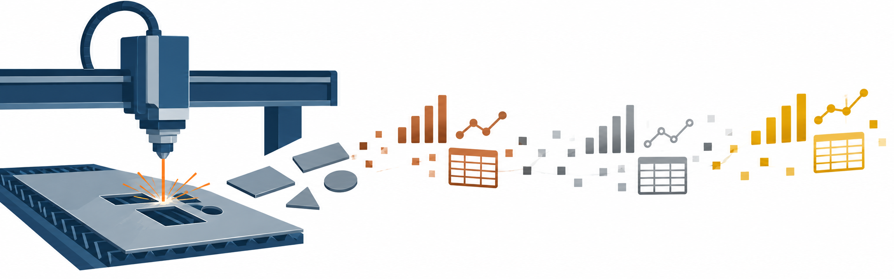
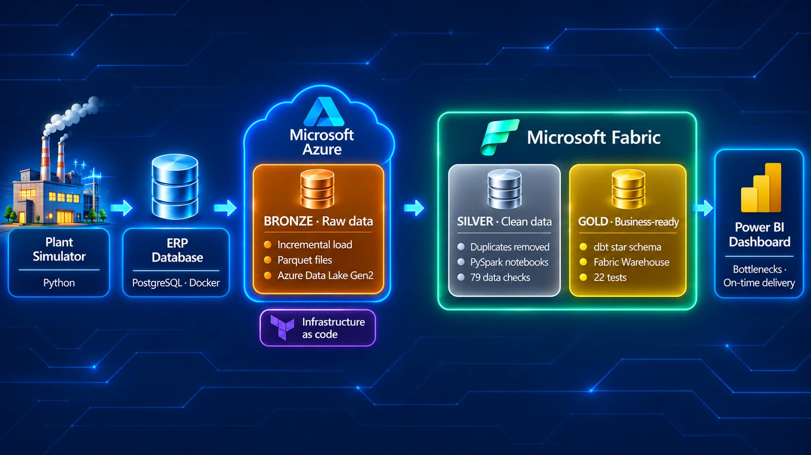
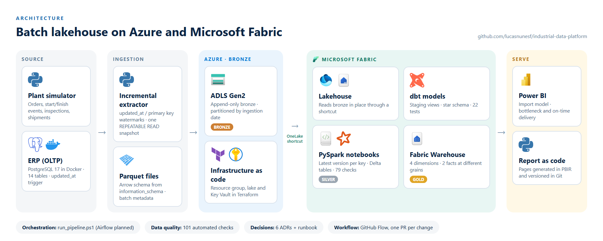
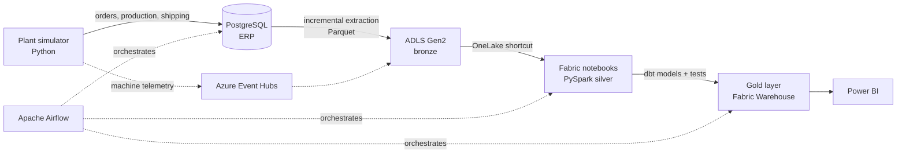
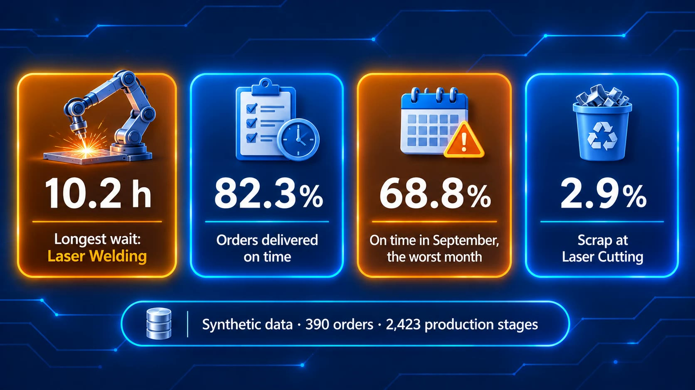
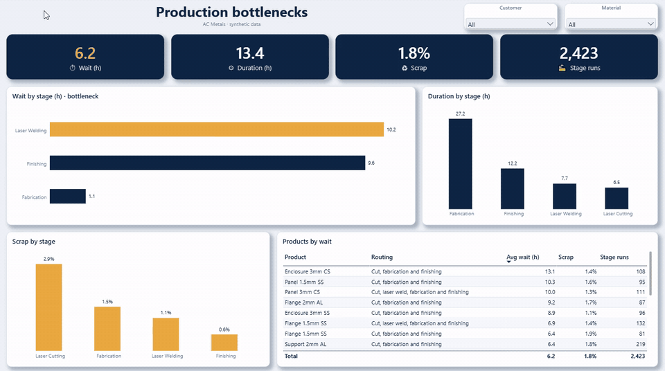
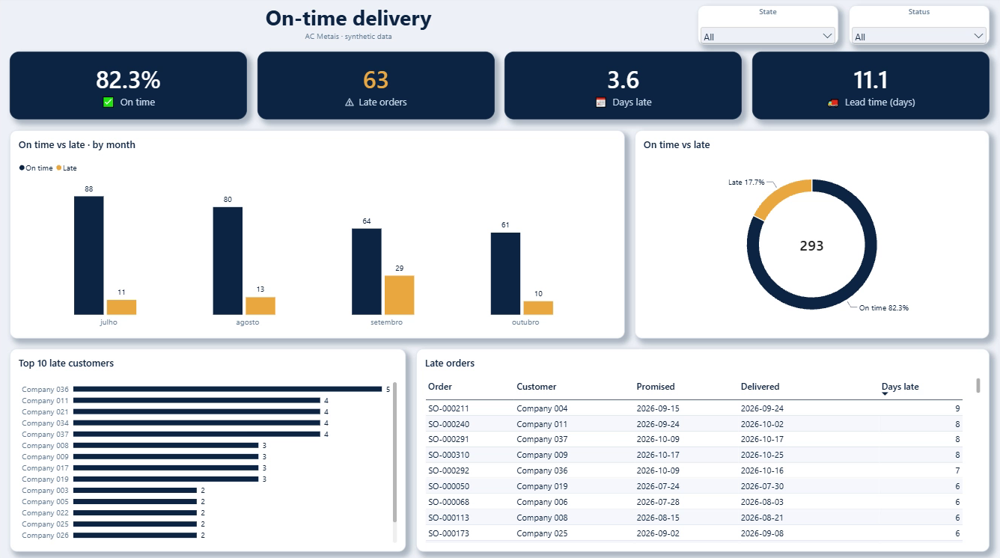
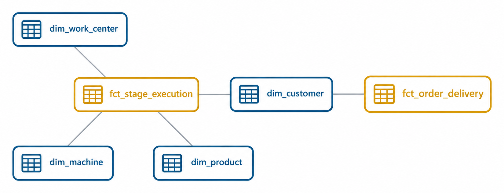

# Industrial Data Platform




End-to-end data engineering platform on **Azure** and **Microsoft Fabric** for metal fabrication plants, built around a real case: **AC Metais**, a Brazilian laser cutting and boilermaking company.

> 🚧 **Work in progress** — see the [Roadmap](#roadmap) for current status.

## The problem

Every order at AC Metais follows the same path:

```
Order → Laser cutting → Fabrication → Finishing → Shipping
```

Questions the business asks every day, and that are hard to answer without a data platform:

- **Where is the bottleneck?** Which stage is slowing orders down?
- **Will this order be late?** What is the real lead time of each stage?
- **How efficient is the laser?** How much time is it idle, and how much sheet metal becomes scrap?
- **What is the real margin of each order** after scrap, rework and machine hours?
- **Are we delivering on time?**

## The solution

A cloud data platform that extracts data from the plant's ERP, organizes it in a lakehouse with bronze, silver and gold layers, and turns it into decisions for production planning.





<details>
<summary><b>Technical architecture</b> (solid = built, dashed = planned)</summary>



Each step and its trade-offs are recorded in [docs/decisions.md](docs/decisions.md).

</details>

### How the data flows

| Layer | What happens | Where |
|---|---|---|
| **Source** | A simulator writes orders, production events, inspections and shipments into a PostgreSQL ERP | Docker |
| **Bronze** | Only rows that changed since the last run are extracted to Parquet and uploaded to the lake | ADLS Gen2 |
| **Silver** | PySpark keeps the latest version of each row and runs data quality checks | Fabric Lakehouse (Delta) |
| **Gold** | dbt builds a star schema with tests | Fabric Warehouse |
| **Consumption** | Dashboard for production planning | Power BI |

## Dashboard





| Production bottlenecks | On-time delivery |
|---|---|
|  |  |

Power BI on top of the gold layer. Orders wait the longest before laser welding and finishing, and 82% of the delivered orders arrived on time, with a dip in September. The report pages are generated as code; see [powerbi/](powerbi/).

## Data model

The gold layer is a star schema with two facts at different grains, sharing the customer dimension.



| Table | Grain | Answers |
|---|---|---|
| `fct_stage_execution` | one row per production order and routing step | lead time per stage, bottlenecks, scrap |
| `fct_order_delivery` | one row per sales order | order lead time, days late, on-time delivery |

### Modules

| Module | Business question | Status |
|---|---|---|
| **Production planning (PCP)** | Bottlenecks, lead time per stage, late orders | ✅ data model ready |
| **Laser machines** | Uptime, OEE, sheet metal yield and scrap | planned (streaming) |
| **Finance** | Real margin per order | planned |
| **Logistics** | On-time delivery, freight cost | partial (on-time delivery) |

## Tech stack

| Layer | Tool | Status |
|---|---|---|
| Source system (ERP) | PostgreSQL (Docker) | ✅ |
| Plant simulator | Python (Faker, psycopg) | ✅ |
| Extraction | Python, incremental by `updated_at` / primary key, Parquet | ✅ |
| Storage (bronze) | Azure Data Lake Storage Gen2 | ✅ |
| Processing (silver) | Microsoft Fabric notebooks (PySpark, Delta Lake) | ✅ |
| Transformation & tests (gold) | dbt (`dbt-fabric`) on Fabric Warehouse | ✅ |
| Infrastructure as code | Terraform (data lake, Key Vault) | ✅ |
| Visualization | Power BI (report pages generated as code, PBIR) | ✅ |
| Streaming | Azure Event Hubs | planned |
| Orchestration (MVP) | PowerShell script, `orchestration/run_pipeline.ps1` | ✅ |
| Orchestration | Apache Airflow | planned |
| CI/CD | GitHub Actions | planned |

## Repository structure

```
erp/             ERP database schema and seed data (SQL)
simulator/       Plant simulator (Python)
ingestion/       Incremental extraction from the ERP and upload to the lake
processing/      Bronze → silver notebooks and data quality checks (PySpark)
dbt/             Silver → gold models and tests (SQL)
powerbi/         Dashboard measures (DAX), layout and report generator
infra/           Terraform
docs/            Assumptions, technical decisions and images
orchestration/   Pipeline runner script (Airflow DAGs planned)
tests/           Automated tests (planned)
```

## Quick start

Requirements: Docker Desktop. The cloud steps also need an Azure subscription (Terraform in `infra/`) and a Microsoft Fabric workspace with a Lakehouse and a Warehouse.

**1. Source and bronze (local)**

```bash
cp .env.example .env                        # then set your own password
docker compose up -d                        # PostgreSQL ERP, schema and seed load on first start
docker compose run --rm --build simulator   # simulate the plant from 2026-07-01 until now
docker compose run --rm --build extractor   # extract what changed into Parquet (ingestion/out/bronze)
```

**2. Upload to the data lake** (requires `az login` and `pip install -r ingestion/requirements-upload.txt`):

```bash
python ingestion/upload.py --account <storage account name>
```

**3. Silver (Fabric).** The Lakehouse reads `bronze/erp` through a OneLake shortcut ([ADR-004](docs/decisions.md)). Import the notebooks from `processing/silver/`, attach the Lakehouse as the default one and run `01_build_silver` then `02_test_silver`.

**4. Gold (dbt).** Requires `pip install dbt-fabric` (Python 3.12) and the Warehouse SQL endpoint:

```powershell
$env:FABRIC_SQL_HOST = "<warehouse>.datawarehouse.fabric.microsoft.com"
az login --allow-no-subscriptions     # the account that owns the Fabric workspace
dbt build --project-dir dbt --profiles-dir dbt
```

`orchestration/run_pipeline.ps1` chains all four steps and pauses for the manual silver run in Fabric.

The simulator is deterministic and incremental: running it again only adds what happened since the last run and updates the status of open orders — like a live ERP. Use `--until "2026-11-03 12:00"` to stop at a given time.

The ERP is available at `localhost:5433` (database `erp`) for any SQL client. Simulation assumptions are documented in [docs/assumptions.md](docs/assumptions.md).

## Design notes and limitations

- **Silver is rebuilt in full on every run.** It is simple and idempotent at this volume ([ADR-005](docs/decisions.md)).
- **`wait_minutes` and `duration_minutes` are wall-clock times**, so both include nights and weekends: the simulated plant runs one shift from Monday to Friday. They compare stages with each other but are not idle time or machine time ([ADR-006](docs/decisions.md)).
- **The first stage of a routing has no wait**, because wait is measured from the end of the previous stage.
- **Key Vault is provisioned but not used yet.** Fabric reads the lake with a SAS token kept in the Fabric connection, because the workspace and the Azure subscription belong to different tenants.
- **The SAS token expires** and must be renewed; see the [runbook](docs/runbook.md).
- **There is no automated test suite for the Python code yet.** Data quality is covered by the silver checks and the dbt tests.

## Roadmap

- [x] **Phase 0 — Foundations:** local environment, Git, Docker, project structure
- [x] **Phase 1 — ERP & plant simulator:** PostgreSQL ERP schema and Python simulator generating orders, production orders and stage events
- [x] **Phase 2 — Batch lakehouse:** incremental extraction to Parquet, ADLS Gen2 bronze with Terraform, silver in Microsoft Fabric with data quality checks
- [x] **Phase 3 — PCP modeling:** dbt star schema for lead time, bottlenecks and on-time delivery, with tests
- [x] **MVP:** Power BI dashboard for bottlenecks and on-time delivery
- [ ] **Phase 4 — Laser streaming:** real-time machine telemetry, OEE and scrap
- [ ] **Phase 5 — Automation:** Airflow orchestration and CI/CD
- [ ] **Phase 6 — Finance & logistics:** margin per order and freight cost
- [ ] **Phase 7 — Showcase:** final dashboards, documentation and demo video

## About the data

All data in this project is **synthetic**, generated by a simulator built for this project. The production flow and business problems are based on the real operation of AC Metais, used with the owner's permission. No real company data is published.

## Author

**Lucas Fernandes Nunes** · [GitHub](https://github.com/lucasnunesf) · [LinkedIn](https://www.linkedin.com/in/lucasfernandesnunes)
