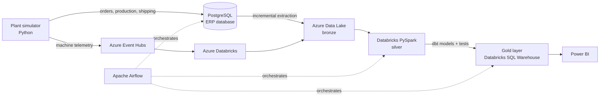

# Industrial Data Platform

End-to-end data engineering platform on **Azure** for metal fabrication plants, built around a real case: **AC Metais**, a Brazilian laser cutting and boilermaking company.

> 🚧 **Work in progress** — see the [Roadmap](#roadmap) for current status.

## The problem

Every order at AC Metais follows the same path:

```
Order → Laser cutting → Metalworking / Boilermaking → Finishing → Shipping
```

Questions the business asks every day, and that are hard to answer without a data platform:

- **Where is the bottleneck?** Which stage is slowing orders down?
- **Will this order be late?** What is the real lead time of each stage?
- **How efficient is the laser?** How much time is it idle, and how much sheet metal becomes scrap?
- **What is the real margin of each order** after scrap, rework and machine hours?
- **Are we delivering on time?**

## The solution

A cloud data platform that extracts data from the plant's ERP and machines, organizes it in a lakehouse and turns it into decisions for production planning, finance and logistics.



### Modules

| Module | Business question | Main techniques |
|---|---|---|
| **Production planning (PCP)** | Bottlenecks, lead time per stage, late orders | Event modeling, daily snapshots |
| **Laser machines** | Uptime, OEE, sheet metal yield and scrap | Streaming, time windows, high volume |
| **Finance** | Real margin per order | Costing, slowly changing dimensions, real BRL exchange rates |
| **Logistics** | On-time delivery, freight cost | Shipping integration, OTD metrics |

## Tech stack

**Architecture:** the plant's ERP runs on a relational (OLTP) database. Data is extracted incrementally into a lakehouse on Azure — no separate data warehouse. Data is stored once in the data lake and the gold layer is served with SQL.

| Layer | Tool |
|---|---|
| Cloud | Microsoft Azure |
| Source system (ERP) | PostgreSQL (Docker) |
| Storage (data lake) | Azure Data Lake Storage Gen2 + Delta Lake |
| Streaming ingestion | Azure Event Hubs |
| Processing | Azure Databricks (PySpark, SQL) |
| Serving (warehouse layer) | Databricks SQL Warehouse |
| Transformation & tests | dbt |
| Orchestration | Apache Airflow (Docker) |
| Simulator runtime | Python on Azure Container Apps |
| Security & monitoring | Azure Key Vault, Azure Monitor, Cost Management |
| Infrastructure & DevOps | Terraform, Docker, GitHub Actions |
| Visualization | Power BI |

## Repository structure

```
erp/             ERP database schema (SQL) and local setup
simulator/       Plant simulator (Python)
ingestion/       Extraction from the ERP and Event Hubs ingestion
databricks/      Bronze → silver processing (PySpark)
dbt/             Silver → gold models and tests (SQL)
orchestration/   Airflow DAGs
infra/           Terraform
docs/            Architecture and technical decisions
tests/           Automated tests
```

## Roadmap

- [x] **Phase 0 — Foundations:** local environment, Git, Docker, project structure
- [ ] **Phase 1 — ERP & plant simulator:** PostgreSQL ERP schema and Python simulator generating orders, production orders and stage events
- [ ] **Phase 2 — Batch lakehouse:** incremental extraction from the ERP into the Data Lake + Databricks with bronze and silver layers
- [ ] **Phase 3 — PCP modeling:** dbt models for lead time, bottlenecks and data quality tests
- [ ] **MVP:** first Power BI dashboard
- [ ] **Phase 4 — Laser streaming:** real-time machine telemetry, OEE and scrap
- [ ] **Phase 5 — Automation:** Airflow orchestration, CI/CD and infrastructure as code
- [ ] **Phase 6 — Finance & logistics:** margin per order and on-time delivery
- [ ] **Phase 7 — Showcase:** final dashboards, documentation and demo video

## About the data

All data in this project is **synthetic**, generated by a simulator built for this project. The production flow and business problems are based on the real operation of AC Metais, used with the owner's permission. No real company data is published.

## Author

**Lucas Fernandes Nunes** · [GitHub](https://github.com/lucasnunesf) · [LinkedIn](https://www.linkedin.com/in/lucas-fernandes-nunes-335867256/)
