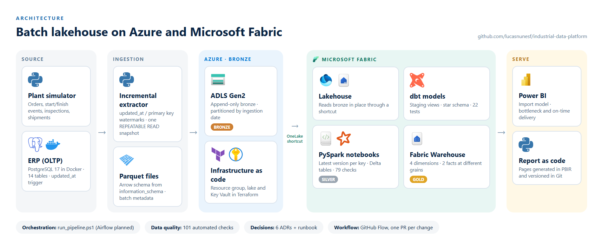
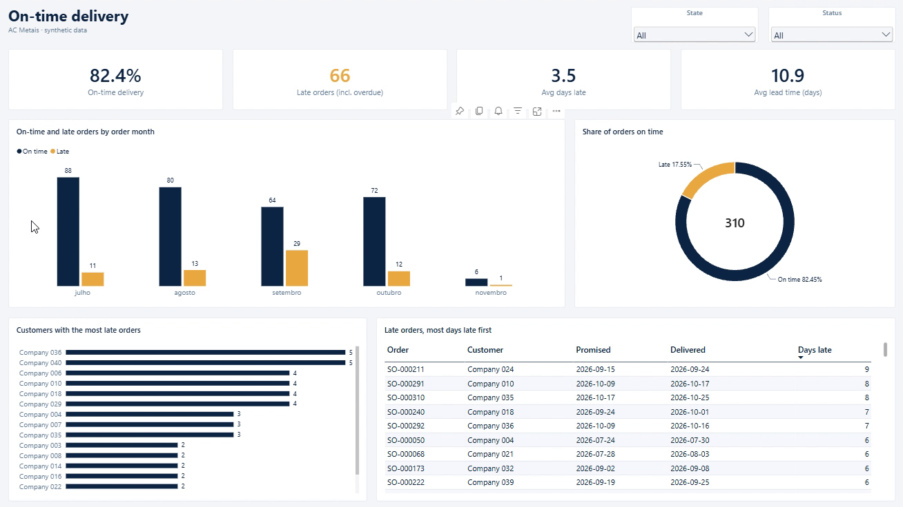
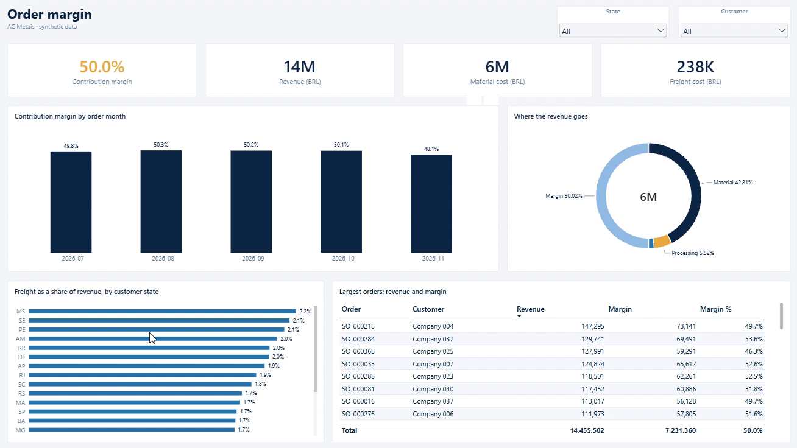

# Industrial Data Platform

A data platform on **Azure** and **Microsoft Fabric** that turns the records of a metal fabrication plant into a Power BI report: where orders get stuck, whether they arrive on time, and how much margin each order keeps.

## The problem

At AC Metais, a Brazilian laser cutting and metal fabrication company, every order follows the same path: laser cutting, fabrication, finishing and shipping. Some products also go through laser welding.

The ERP records every step, but only as raw rows. Simple questions, such as which stage holds orders back or which customers get late deliveries, meant exporting spreadsheets and joining them by hand.


## How it works

| Step | What happens | Tools |
|---|---|---|
| **1. Source** | A simulator writes orders, production events and shipments into an ERP database | PostgreSQL, Python |
| **2. Bronze** | Each run copies only the rows that changed to the data lake, as Parquet files | Python, Azure Data Lake Storage |
| **3. Silver** | Removes duplicates, keeps the latest version of each row and runs 88 data quality checks | Microsoft Fabric Lakehouse |
| **4. Gold** | SQL models build a star schema, with 34 tests | dbt, Fabric Warehouse |
| **5. Report** | Three report pages with DAX measures | Power BI |



## Dashboard

| Production bottlenecks | On-time delivery | Order margin |
|---|---|---|
|  |  |  |

- Orders wait the longest before laser welding: about 9 hours on average.
- 82% of the orders were on time, with a dip in September. An order past its promised date and not delivered yet counts as late.
- Shipped orders keep about half of their revenue after material, processing and freight.

The DAX measures are in [powerbi/measures.dax](powerbi/measures.dax).

## Data model

A star schema with three facts that share the customer dimension. The SQL is in [dbt/models](dbt/models).

- `fct_stage_execution`: one row per production order and stage. Wait time, duration and scrap per stage.
- `fct_order_delivery`: one row per sales order. Lead time, days late and on-time delivery.
- `fct_order_margin`: one row per shipped order. Revenue, material, processing and freight cost, and margin.

## How to run

The source and the extraction run locally with Docker:

```bash
cp .env.example .env                        # then set your own password
docker compose up -d                        # ERP database, schema and seed data
docker compose run --rm --build simulator   # simulate the plant from 2026-07-01 until now
docker compose run --rm --build extractor   # extract what changed to Parquet
```

The cloud steps (upload to the lake, silver in Fabric, dbt) need an Azure subscription and a Fabric workspace. They are in the [runbook](docs/runbook.md).

## About the data

All data is **synthetic**, generated by a simulator built for this project. The production flow and the business questions come from the real operation of AC Metais, used with the owner's permission. No company data is published. Prices and rates are simulated; only the USD/BRL exchange rate is real. More in [docs/assumptions.md](docs/assumptions.md).

## Background

The problem, the business rules and the design decisions are mine. They come from my work on the data platform at AC Metais.

## Technical details

- The silver layer runs as PySpark notebooks in Fabric and writes Delta tables.
- The data lake is created with Terraform (`infra/`).
- `orchestration/` has a PowerShell script that runs the steps in order, and an Airflow DAG with the same steps.
- GitHub Actions runs the Python tests, ruff, `terraform validate` and `dbt parse` on every pull request.
- Design decisions and limitations: [docs/decisions.md](docs/decisions.md).

## Author

**Lucas Fernandes Nunes** · [GitHub](https://github.com/lucasnunesf) · [LinkedIn](https://www.linkedin.com/in/lucasfernandesnunes)
